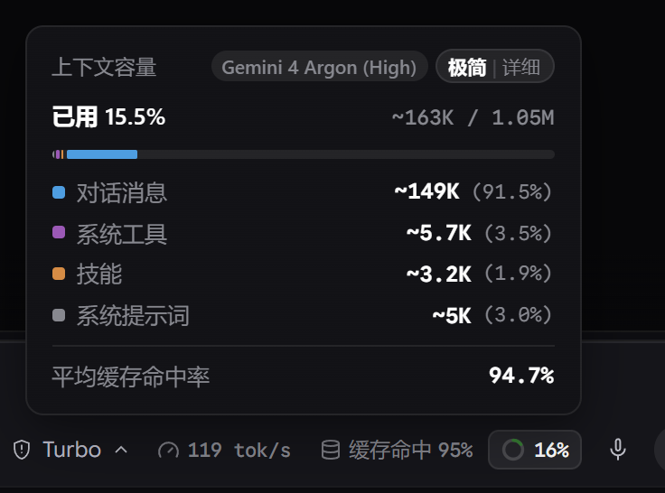
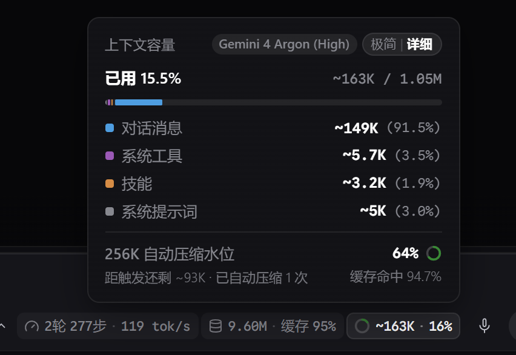
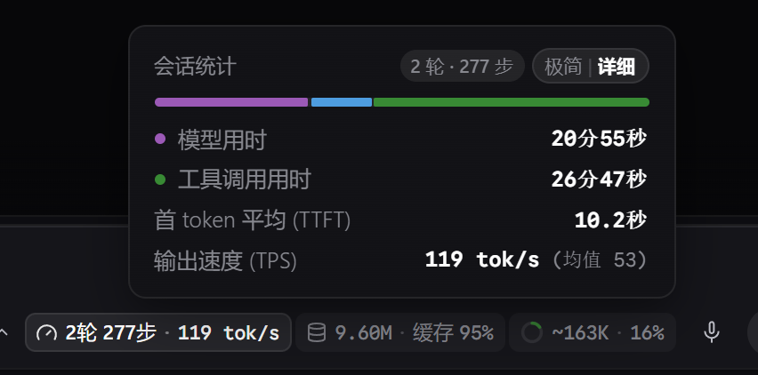
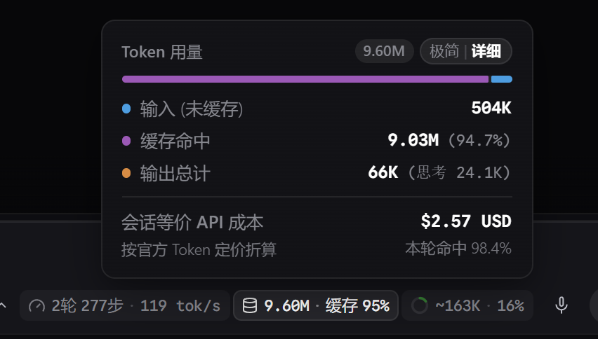

# Antigravity Pulse

为 **Google Antigravity 2.0** 打造的原生底栏遥测组件（HUD），紧贴聊天栏右侧麦克风旁，实时显示 **Token 速率 (TPS)**、**缓存命中率** 与 **上下文容量拆解**，支持 **极简 (`Minimal`) / 详细 (`Pro`)** 双模式切换与 **系统语言（中/英）自动识别**。

---

## 界面预览 (Screenshots)

| 极简模式 · 上下文容量 (`Minimal`) | 详细模式 · 上下文与 256K 压缩水位 (`Pro`) |
| :---: | :---: |
|  |  |

| 详细模式 · 会话统计 (`Pro`) | 详细模式 · Token 用量与成本 (`Pro`) |
| :---: | :---: |
|  |  |

---

## 核心特性

- **原生视觉与主题自适应**：1:1 对齐 Antigravity 2.0 官方弹窗规范，完整展示当前模型与推理强度档位（如 `Gemini 4 Argon (High)`），基于内置 CSS 变量自动适配浅色 / 深色主题。
- **系统语言自动识别 (i18n)**：自动检测用户系统显示语言（`zh` / `en`），在纯中文与纯英文界面间自适应切换。
- **双模式热切换 (`Minimal` ⇄ `Pro`)**：
  - **`Minimal` 极简模式**：底栏仅展示速率、缓存命中率、上下文占比及精简浮窗。
  - **`Pro` 详细模式**：新增轮次/步数、三段式耗时分布条（思考 / 输出 / 工具）、等价 API 成本估算及 `256K` 自动压缩水位进度环。
- **无头后台守护**：通过 Antigravity 原生 `sidecar.json` (`has_web_ui: false`) 静默运行，零额外面板干扰。

---

## 安装

### 方式一：直接克隆至插件目录（推荐）

**Windows (PowerShell):**
```powershell
git clone https://github.com/hhanmj/antigravity-pulse.git "$env:USERPROFILE\.gemini\config\plugins\context-monitor"
```

**macOS / Linux:**
```bash
git clone https://github.com/hhanmj/antigravity-pulse.git ~/.gemini/config/plugins/context-monitor && bash ~/.gemini/config/plugins/context-monitor/install.sh
```

### 方式二：安装脚本

```bash
git clone https://github.com/hhanmj/antigravity-pulse.git
cd antigravity-pulse
# Windows: .\install.bat
# macOS / Linux: chmod +x install.sh && ./install.sh
```

---

## 交互说明

| 操作 | 说明 |
| :--- | :--- |
| **悬停胶囊** | 展开对应维度浮窗（会话统计 / Token 用量 / 上下文容量） |
| **左键点击胶囊** | 固定（Pin）当前浮窗，再次点击或点击外部区域关闭 |
| **右键点击胶囊** / **点击浮窗右上角 `[极简 \| 详细]`** | 在 `Minimal` 与 `Pro` 模式间切换（自动持久化） |

---

## License

[MIT](./LICENSE)
